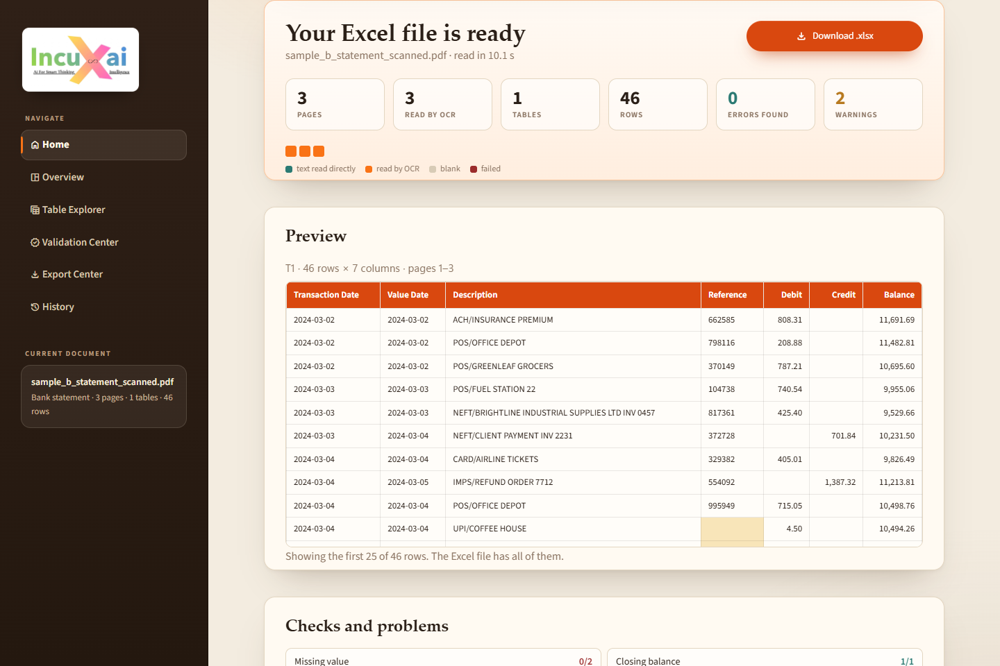
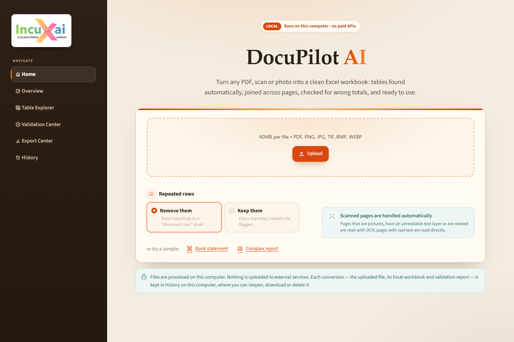
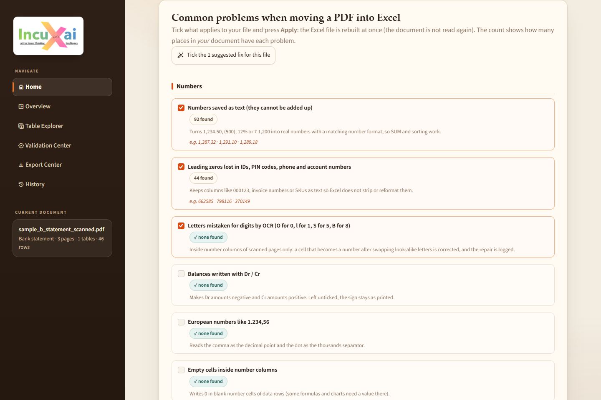
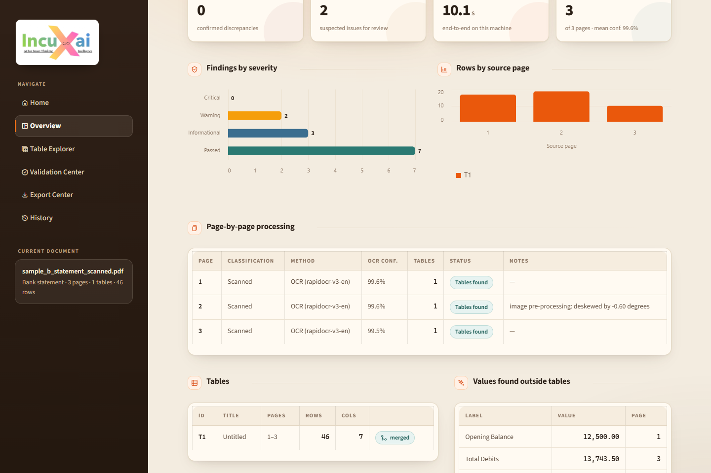
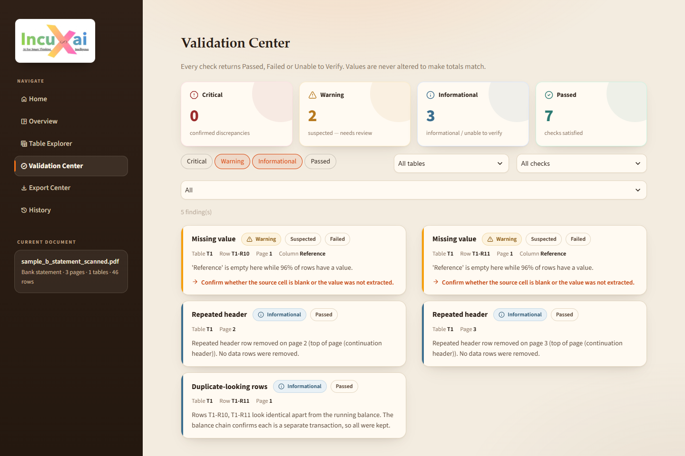
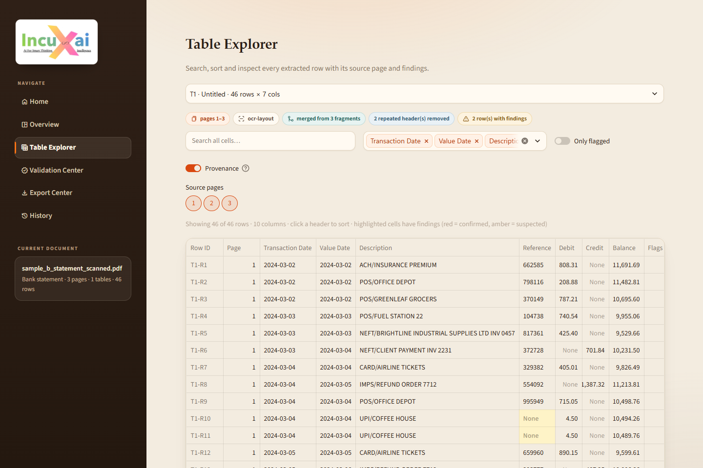
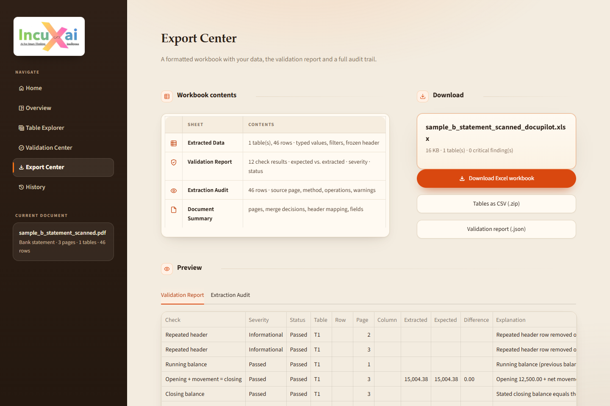
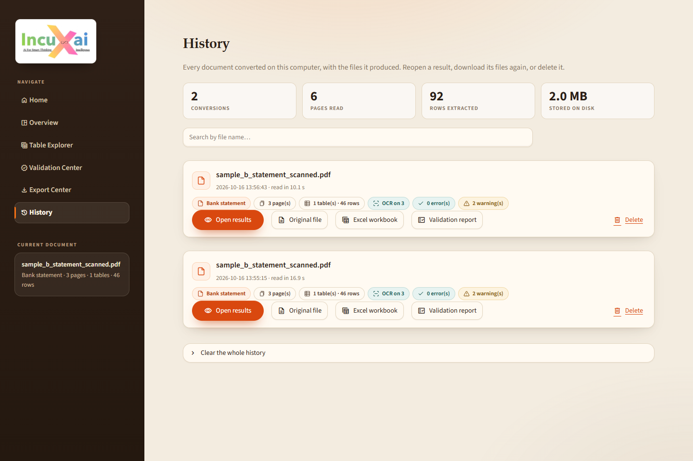

# DocuPilot AI

**Turn any PDF, scan or photo into a clean, checked Excel workbook.** An IncuXai project.

DocuPilot AI finds the tables in PDFs, scanned documents and images, joins tables that continue across pages, checks
the numbers (line arithmetic, totals, running balances, row totals, duplicates, gaps, date order, misalignment), and
exports a formatted workbook with a validation report and a full extraction audit trail. A clean-up checklist fixes
the usual PDF-to-Excel problems in one click, and every conversion is kept in History with its files.

Everything runs on your machine. There are no API keys and no paid services, and no document content is sent anywhere.




---

## Contents

1. [Features](#features)
2. [Quick start (Windows)](#quick-start-windows)
3. [Linux / macOS](#linux--macos)
4. [Using the app](#using-the-app)
5. [Architecture](#architecture)
6. [Technology choices](#technology-choices)
7. [Validation rules](#validation-rules)
8. [Samples, tests and accuracy](#samples-tests-and-accuracy)
9. [Optional local LLM](#optional-local-llm)
10. [Security and privacy](#security-and-privacy)
11. [Hardware and performance](#hardware-and-performance)
12. [Troubleshooting](#troubleshooting)
13. [Known limitations](#known-limitations)
14. [Licenses and attribution](#licenses-and-attribution)

---

## Features

| Area | What it does |
|---|---|
| **Inputs** | Digital PDFs, scanned (image-only) PDFs, mixed PDFs, PNG/JPG/TIFF/BMP/WEBP. Up to **50 pages**, 60 MB. A longer file is not refused: its first 50 pages are converted and the result says so. Malformed, empty and password-protected files are rejected with a clear message. |
| **Upload options** | *Repeated rows*: **Remove them** (exact repeats are left out and listed on a **Removed rows** sheet) or **Keep them** (every row is kept and repeats are flagged). OCR needs no choice: the engine decides per page (pictures, unreadable text layers and rotated pages are OCR'd; mixed pages are read both ways and the better tables kept; a text page that yields no usable table but carries images is retried with OCR). The engine still accepts `ocr_mode="force"` / `"off"` for scripts. |
| **Clean-up checklist** | 16 common PDF-to-Excel problems in five groups (numbers, dates, text, rows and totals, workbook): numbers saved as text, lost leading zeros, OCR letter/digit mix-ups, Dr/Cr balances, European `1.234,56` numbers, blank number cells, dates as text, US month/day dates, hidden spaces, hyphenated line breaks, ALL-CAPS text, group names only on the first row, duplicate rows, total rows mixed with data, blank rows/columns, and cell highlighting. Each shows how many places in **your** document have it, with examples, and is marked *Suggested* when the document clearly has it. Tick, press **Apply**, and the workbook is rebuilt in well under a second: only clean-up, typing, validation and Excel are re-run on the stored tables; the document is not read again. Every edit goes to the audit trail. |
| **Page classification** | Every page is classified as digital, scanned, mixed or empty (text density, image coverage, garbled glyphs, rotation) and routed to the right extractor. |
| **Digital extraction** | Ruled tables via pdfplumber; borderless tables via a geometric word-clustering reconstructor (column gaps from an occupancy profile, multi-line headers, wrapped cells). A ruled table whose rows come out malformed is re-extracted with the geometric method. |
| **OCR** | PaddleOCR PP-OCRv5 (English) via RapidOCR/ONNX Runtime on CPU. Pages are deskewed (projection-profile search), sideways content is detected and rotated, ruled grids are detected with OpenCV, and words are rebuilt into tables with the same geometric reconstructor. |
| **Wide tables** | Tested with 10-, 12- and 14-column tables. |
| **Multi-page stitching** | An evidence-scored merge (repeated header, "continued" titles, column geometry, data-type agreement, page position) with hard stops for a different header, a different column count, or other content in between. A row split across a page break is re-joined. An identical row at a page boundary is removed only when a running balance proves it is a reprint; otherwise it is kept and flagged. Every decision is logged. |
| **Header normalisation** | Superficial variants are normalised ("Txn Date" → "Transaction Date", OCR typos such as "Descripton") while distinct concepts stay distinct (Debit ≠ Credit, Posting date ≠ Value date). Original headers are kept in the audit. |
| **Typing** | Negatives (`-1.00`, `(1.00)`, `1.00-`), currencies, thousands separators (including Indian and European), percentages and dates (with day/month order inferred per column). Identifiers stay text, so leading zeros survive. Audited OCR repairs, such as `1O0.00 → 100.00` or `10.695.60 → 10,695.60`, apply only in numeric columns of OCR rows. Markdown emphasis that documents carry as literal characters (`**Total**`, `__Due__`) is removed from words, cells, headers and titles, so `**65.00**` is still the number 65.00; a single `*` (footnote mark) is kept. |
| **Validation** | Deterministic `Decimal` arithmetic. Every check returns **Passed / Failed / Unable to Verify**. Results are split into confirmed errors and suspected anomalies. Values are never changed to make totals match. |
| **Excel** | *Extracted Data* (typed values, Excel tables with filters, frozen headers, number formats, highlighted cells with explanatory comments), *Validation Report*, *Extraction Audit*, *Document Summary* (including a checks table with items looked at / correct, and the clean-up options applied), one sheet per table when there are several, plus *Totals* and *Removed rows* sheets when those options apply. |
| **History** | Every conversion is kept on this computer with its uploaded file, Excel workbook, validation report and saved result. Reopen a past result instantly (the document is not read again), download any of its files again, or delete it. |
| **UI** | Streamlit app with a warm design: paper-coloured surfaces, a dark sidebar with the IncuXai logo, orange accents and serif headings. The sidebar is fixed on desktop (no collapse or resize) and collapsible on phones. Home is a single flow: upload with options → live stage tracker → *Your Excel file is ready* with download, key numbers and a per-page strip showing how each page was read → table preview with flagged cells → checks (passed/checked per check) and problems → clean-up checklist. Overview, Table Explorer, Validation Center, Export Center and History go deeper. |

## Quick start (Windows)

Requirements: **Python 3.11** (3.10–3.12 should work; 3.11 is what was tested). Internet access is needed once, for `pip` and the ~8 MB OCR model.

```powershell
cd docupilot-ai
py -3.11 -m venv .venv
.venv\Scripts\python.exe -m pip install --upgrade pip
.venv\Scripts\python.exe -m pip install -r requirements.txt
.venv\Scripts\python.exe scripts\download_models.py      # optional: pre-fetch the OCR model
run.bat                                                  # or: .venv\Scripts\python.exe -m streamlit run app.py
```

Then open http://localhost:8501.

**Development and tests:**

```powershell
.venv\Scripts\python.exe -m pip install -r requirements-dev.txt
.venv\Scripts\python.exe -m pytest                       # 135 tests, about 1 minute
.venv\Scripts\python.exe scripts\evaluate.py            # accuracy report -> reports\evaluation_report.md
```

## Linux / macOS

```bash
python3.11 -m venv .venv
.venv/bin/pip install -r requirements.txt          # add requirements-dev.txt for tests
.venv/bin/python scripts/download_models.py
./run.sh
```

On minimal Linux images, OpenCV may need `libgl1` and `libglib2.0-0` (`apt install libgl1 libglib2.0-0`). Linux was not tested for this release; the code has no Windows-specific paths.

## Using the app

1. **Home**: drop a file, choose whether to remove repeated rows, and click **Convert to Excel**. Or click one of the synthetic samples (bank statement, complex report), which converts straight away.
2. **Processing**: a live tracker shows the seven real stages (inspection, classification, text/OCR, table detection, multi-page reconstruction, validation, Excel), the page being processed, OCR page count and a ticking elapsed timer. The progress bar is computed from completed stages and processed pages, not a fake percentage.
3. **Results (on Home)**: download the workbook, see pages / OCR pages / tables / rows / errors / warnings and a coloured square per page (text read directly, OCR, blank, failed; hover for OCR confidence). Below: a preview of each table (first 25 rows, flagged cells coloured with the finding as a tooltip), the checks with passed/checked counts and the problems found, and the **clean-up checklist**. Use **Tick the suggested fixes**, adjust, then **Apply to the Excel file**.
4. **Overview**: real KPIs (pages, tables, rows, columns, critical errors, warnings, time, OCR usage), findings by severity, rows per source page, a page-by-page processing table, tables, and values found outside tables.
5. **Table Explorer**: switch tables; search, sort and filter; choose columns for wide tables; filter by source page or flagged rows. Cells with findings are highlighted. Below the table: a row inspector (raw vs typed values, operations, findings), merge decisions, repeated headers removed, duplicates and missing values, and the header mapping.
6. **Validation Center**: Critical / Warning / Informational / Passed counts, filters by table, check and certainty, and one card per finding with location, extracted, expected and difference values, an explanation and a suggested action.
7. **Export Center**: download the `.xlsx` workbook, CSV files (zip) or the validation report (JSON), and preview the report and audit.
8. **History**: every conversion with its date, type, pages, tables, rows, errors and warnings. For each run: **Open results** (reopens it instantly, without reading the document again), download the **original file**, the **Excel workbook** or the **validation report**, or **Delete** it. Search by file name; totals and disk use are shown at the top.

Results are kept per browser session and keyed by file hash, so navigating or re-rendering never re-processes a document. Converting the same file again (for example with other upload options) replaces the result in the session and adds a new History entry.

| Home | Clean-up checklist |
|---|---|
|  |  |
|  |  |
|  |  |
|  | |

## Architecture

```text
app.py                      Streamlit UI (pages, session state, progress rendering)
ui/                         design system: styles.css, components.py (HTML builders, SVG icons), charts.py,
                            assets/incuxai_logo.png (sidebar logo)
core/
  agent_orchestrator.py     pipeline + recovery decisions + progress events
  document_inspector.py     open/validate PDF or image, page classification, page limit
  pdf_extractor.py          pdfplumber ruled tables + geometric fallback (digital pages)
  ocr_engine.py             render, deskew, orientation, RapidOCR, grid detection (scanned pages)
  table_detector.py         geometric table reconstruction from positioned words (shared by both paths)
  table_merger.py           multi-page stitching with evidence scoring and boundary-row handling
  header_normalizer.py      synonym/abbreviation rules, semantic roles, header similarity
  data_normalizer.py        summary-row detection, column typing, audited OCR repairs
  field_extractor.py        totals and balances outside tables, document type
  cleanup.py                clean-up checklist: problem detection (counts, examples, suggestions) and fixes
  validator.py              rule-based checks (Decimal arithmetic) and per-check passed/checked summary
  excel_exporter.py         workbook generation (openpyxl)
  value_parser.py           numbers, negatives, currencies, percentages, dates
  models.py                 dataclasses shared across stages
models/local_llm.py         optional Ollama client (localhost only)
config/settings.py          central settings, overridable with DOCUPILOT_* environment variables
utils/                      file validation, JSON logging, run history (files + metrics)
scripts/                    sample generator, evaluation, stress probe, LLM demo, model pre-fetch
tests/                      pytest suite (135 tests, including headless UI workflow tests)
```

**Pipeline and recovery:**

```text
upload -> validate (type by magic bytes, size, name) -> open (reject encrypted/corrupt; keep the first 50 pages)
  -> classify pages: digital | scanned | mixed | empty
  -> text: pdfplumber words (digital) | render 200 dpi + deskew + orientation + OCR (scanned/mixed/rotated)
           (literal markdown markers such as **bold** are stripped from words)
  -> tables: ruled grid (pdfplumber / OpenCV) -> geometric layout reconstruction
       recovery: malformed ruled table -> layout method; weak native page with images -> OCR retry;
                 mixed page -> keep the better of native vs OCR; failing page -> recorded, others continue
  -> stitch fragments across pages (evidence-scored; schema mismatch blocks merge)
  -> clean-up checklist fixes (text, rows) on a copy of the stitched tables
  -> normalise headers, classify summary rows, type columns (typing options from the checklist)
  -> validate -> Excel -> History (uploaded file, workbook, report, saved result)

  "Apply" on the checklist re-runs only the last four steps on the stored tables.
```

## Technology choices

| Need | Choice | Why |
|---|---|---|
| Digital tables | **pdfplumber** + own geometric reconstructor | pdfplumber is precise for ruled tables. The custom reconstructor handles borderless tables and OCR output with one algorithm, so both paths behave the same way. |
| Rendering and inspection | **PyMuPDF** | Fast rendering, image-coverage and rotation inspection, in-memory image-to-PDF. |
| OCR | **RapidOCR** (PaddleOCR PP-OCRv5 English recogniser, PP-OCRv4 detector, ONNX Runtime) | Same PaddleOCR models without the PaddlePaddle framework, which is heavy and fragile on CPU-only Windows. The English model keeps spaces between words (the bundled Chinese/English model drops them). About 5–9 s/page on a laptop CPU. |
| Grid lines, deskew | **OpenCV** | Morphological line detection; projection-profile skew estimate. |
| Data and Excel | **pandas**, **openpyxl** | Standard and reliable; openpyxl gives full control of formats, tables, comments and freeze panes. |
| UI | **Streamlit** + custom CSS/HTML components + **Altair** | Fully local. No external fonts or CDNs; inline SVG icons; usage telemetry disabled. |
| Optional reasoning | **Ollama** (e.g. `gemma3:4b`, `qwen2.5`) | Local, optional, constrained by a JSON schema. |

**Docling was evaluated and not included.** It pulls in PyTorch and several GB of layout models, which adds a lot to installation and CPU time. The pdfplumber + geometric + OCR stack reaches the accuracy below on the test set. Docling would be a reasonable optional fallback for documents where the geometric reconstructor struggles (complex merged-cell layouts).

## Validation rules

Checks run only when the needed columns or fields exist. If information is missing, the result is **Unable to Verify**, never Passed. Conventions are established from the data before any row is failed. For example, the debit/credit sign convention, or what "Line Total" includes, must hold on at least 60% of rows.

| Document | Checks |
|---|---|
| **Invoices** | quantity × unit price − discount = net; net × tax rate = tax; line total = net + tax (convention tested); Σ net = subtotal; Σ tax = tax total; subtotal + tax + shipping − discount = grand total; Σ line totals = subtotal + tax |
| **Statements** | running balance per row (credit-adds, debit-adds or signed-amount convention, whichever the data supports); opening + movement = closing; stated closing = last balance; stated total debits and credits = column sums. Two consecutive failures with opposite differences are explained as one misread balance. |
| **Generic** | row total = sum of the row's numeric cells (with a rounding allowance); "Total" summary rows = column sums; data-type consistency; missing values in well-filled columns (downgraded to informational when the row total proves the blank is genuine); partial column shifts; duplicate-looking rows (never deleted; reported as informational when a balance chain proves both are real); line-number gaps; date order (a date that breaks an otherwise ascending or descending column, often a misread digit); repeated headers; row widths; uncertain merges; failed pages; low OCR confidence |

Severity: **critical** is a confirmed numerical failure, **warning** a suspected issue, **info** informational or unable to verify, **passed** a satisfied check. Cells that cannot be read (for example, OCR-garbled amounts) make dependent sums and chains *Unable to Verify* instead of producing false failures.

## Samples, tests and accuracy

All samples are **synthetic** and generated by `scripts/generate_samples.py`. The ground truth in `samples/expected/*.json` is the exact data the generator draws, and was checked by viewing the rendered pages.

| Sample | Content |
|---|---|
| **A** `sample_a_invoice.pdf` | Digital invoice: 12-column ruled table, 14 lines, wrapped descriptions, a negative return line, totals block. **Planted error:** line 7 Line Total overstated by 10.00. |
| **B** `sample_b_statement_scanned.pdf` | 3-page **image-only** statement (150 dpi, noise, blur, page 2 skewed 0.6°), 7 columns, header repeated on each page, a wrapped description, a description split across the page 2→3 break, and two legitimately identical coffee purchases. |
| **C** `sample_c_report.pdf` | 4 pages: a 14-column ruled table continued on page 2, a borderless 10-column table with empty cells, an unrelated 10-column table on page 3 that must *not* be merged, negatives in parentheses, and a narrative page with no tables. **Planted error:** one FY Total overstated by 10.0. |
| **D** `sample_d_invoice_photo.png` | Sample A as a grayscale image (exercises image upload and OCR grid detection). |

The Home page offers **B** (bank statement) and **C** (complex report) as one-click samples. A and D are used by the tests and the evaluation and can be uploaded from `samples/`.

**Results** (`scripts/evaluate.py`, run on the development machine; full report in `reports/evaluation_report.md`):

| Sample | Cell accuracy | Row completeness | Column alignment | Unwanted duplicates | Planted errors detected | False criticals | Time |
|---|---|---|---|---|---|---|---|
| A invoice (digital) | 100% | 100% | 100% | 0% | 2/2 | 0 | 0.1 s |
| B statement (scanned, 3 pages) | 99.38% | 100% | 100% | 0% | none planted | 0 | ~15–25 s |
| C report (digital, 4 pages) | 100% | 100% | 100% | 0% | 1/1 | 0 | 0.9 s |
| D invoice photo (OCR) | 100% | 100% | 100% | 0% | 2/2 | 0 | ~8–11 s |
| **Overall** | **99.82%** of 1,128 cells | **100%** of 113 rows | **100%** | **0%** | **5/5** | **0** | |

The only misses are two Ref No cells containing a lone "-" that OCR did not read. Both were flagged as *missing value* warnings.

**Read these numbers with care.** The samples were built alongside the extractor, so they show that the pipeline works, not how it performs on unseen documents. As a less optimistic check, `scripts/stress_probe.py` re-scans sample B under conditions *not* used during development:

| Scan condition | Cell accuracy | Rows | Columns | False criticals |
|---|---|---|---|---|
| 150 dpi, noise 9, 0.6° skew on one page (reference) | 99.38% | 100% | 100% | 0 |
| 120 dpi, noise 14, ±1.2° skew on every page | 99.38% | 100% | 100% | 0 |
| 100 dpi, noise 18, ±2.0° skew on every page | 98.76% | 100% | 100% | 0 |

At 100 dpi, OCR misreads thousands commas as periods (repaired and audited) and drops "/" in some descriptions (not repairable; such text errors are not caught by numeric validation). Expect lower accuracy on real-world documents with complex layouts. See [Known limitations](#known-limitations).

**Metric definitions:**

- *Cell accuracy*: exported values versus ground truth, with whitespace normalised; numbers and dates are compared by value.
- *Row completeness*: expected rows aligned to an extracted row by order-preserving DP alignment.
- *Column alignment*: columns matching in at least 95% of aligned rows.
- *Unwanted duplicates*: extracted copies of an already-matched row.
- *Validation recall*: planted discrepancies reported as critical at the right table and row.

**Automated tests**: 135 tests, all passing on the development machine (`pytest`, about 1 minute). They cover:

- number, negative, decimal and date parsing, and markdown-marker stripping (`**Total**`, `__Due__`);
- malformed, encrypted, blank and oversized files, path traversal, and the page limit (50 pages: 500 rows stitched into one table in 1.3 s; a 52-page file converts its first 50 pages and says so);
- wide tables, wrapped cells and empty cells;
- multi-page merging, repeated headers, the continued boundary row, and independent tables with equal column counts;
- legitimate duplicates;
- incorrect totals, running balances, column shifts, sequence gaps, out-of-order dates and unreadable amounts;
- every clean-up checklist fix, its detection counts and suggestions, and the instant rebuild (Totals and Removed rows sheets, cell highlighting on/off);
- history: stored files, reopening a run, updating it after Apply, the checksum check, delete and clear, and metrics-only mode;
- OCR accuracy on the scanned statement and the image upload;
- workbook structure, types, formats, comments and formula-injection protection;
- LLM safety (remote hosts refused, constrained answers, pipeline works without Ollama);
- headless UI workflow tests (sample → results on Home → all pages render, no re-processing on rerender; checklist Apply rebuilds the workbook; the repeated-rows choice reaches the engine; History reopens a stored run).

## Optional local LLM

The app does not use an LLM: the Home page has no LLM option, and every result comes from the rules. The local LLM path remains available to scripts only (`process_document(data, name, use_llm=True)`, used by `scripts/llm_demo.py`) and needs Ollama running on `127.0.0.1:11434`. It has one job: proposing semantic roles for column headers that the rules could not map.

- It receives **only header names**, never cell values.
- Its answers are constrained by a JSON schema to a fixed list of roles. It cannot override a rule-based mapping or assign one role twice.
- Every suggestion is recorded in the audit.

All arithmetic stays in Python. Preferred models (first installed wins) are set in `config/settings.py`. On the development machine, `gemma3:4b` was used and no download was needed.

`scripts/llm_demo.py` measures the value on a statement with headers "Dt / Narrative / Amt Paid Out / Amt Recd / Running Bal":

- **rules only:** debit and credit are not recognised, 0 running-balance checks run, and a planted balance error goes undetected;
- **with gemma3:4b** (about 3 s on CPU): all three headers mapped, 5 of 6 rows verified, and the planted error reported as critical at row T1-R6.

The app is fully functional without an LLM.

## Security and privacy

- **Local processing.** Documents are processed in memory; no temporary files are written. Nothing is uploaded.
- **The one network fetch** is the ~8 MB OCR model, downloaded from ModelScope the first time a scanned page is processed (or by `scripts/download_models.py`). Without network access, the bundled offline models are used.
- **No telemetry, no external assets.** Streamlit usage statistics are disabled (`.streamlit/config.toml`), and there are no external fonts or CDNs.
- **Local LLM only.** The Ollama client refuses non-localhost hosts unless `DOCUPILOT_ALLOW_REMOTE_LLM=1` is set.
- **Upload validation.** Extension allow-list, magic-byte check, size limit, and filename sanitisation (directory components stripped, so path traversal is blocked).
- **No formula injection.** Extracted text is never executed. Text starting with `=` is written to Excel as a string, not a formula.
- **Logs hold metadata only.** Logs (`logs/`, JSON lines) contain stage, timing and count data, never cell contents.
- **History keeps your files, locally.** Each conversion is listed in `reports/history.json` and, by default, gets a folder `reports/history/<run id>/` with the uploaded document, the Excel workbook (replaced when clean-up options are re-applied), the validation report (JSON) and the saved result, so the History page can reopen a run instantly and re-download every file. A saved result is reopened only if its SHA-256 matches the one recorded when the app wrote it. Delete one run or clear everything from the History page. `DOCUPILOT_HISTORY_FILES=0` keeps metrics only (no document contents); `DOCUPILOT_HISTORY=0` disables history entirely. The newest 200 runs are kept.

## Hardware and performance

Developed and measured on an Intel i7-1255U laptop (10 cores), 16 GB RAM, no GPU, Windows 11, Python 3.11.

| Workload | Time |
|---|---|
| Digital pages | about 20–40 ms per page (50-page document: 1.3 s end to end) |
| Scanned pages | about 5–9 s per page at 200 dpi (detection capped at 1280 px; recognition uses full-resolution crops), plus about 1–4 s for the first model load |
| Optional LLM header mapping | about 3–16 s per document with gemma3:4b on CPU |

Minimum: 4 GB free RAM and a 64-bit CPU. A 50-page scanned document takes several minutes on CPU.

Settings can be overridden with environment variables: `DOCUPILOT_MAX_PAGES`, `DOCUPILOT_MAX_FILE_MB`, `DOCUPILOT_OCR_DPI`, `DOCUPILOT_OLLAMA_HOST`, `DOCUPILOT_OCR_BACKEND` (`auto` or `legacy`), `DOCUPILOT_REPORTS_DIR`, `DOCUPILOT_LOGS_DIR`, `DOCUPILOT_HISTORY`, `DOCUPILOT_HISTORY_FILES`.

## Troubleshooting

| Symptom | Fix |
|---|---|
| Overview's page table shows the method `OCR (rapidocr-onnxruntime-ch)` | The English model could not be downloaded. Run `scripts/download_models.py` with internet access. The fallback works, but often drops spaces in English text. |
| `scripts/llm_demo.py`: "Ollama not reachable" | Start Ollama (`ollama serve`) and make sure a model is installed (`ollama list`). The app itself does not need it. |
| `ImportError: libGL.so.1` (Linux) | `apt install libgl1 libglib2.0-0` |
| Scanned page shows "No tables" | Check the page-by-page table for OCR confidence. Very low-resolution or handwritten pages are not supported. Try a higher-quality scan, or raise `DOCUPILOT_OCR_DPI`. |
| Dates look swapped | When a column has no day above 12, day/month order cannot be proven. The column is read day-first and a warning is shown on the table. |
| Upload rejected | Check the message: password-protected PDFs, a file over 60 MB, and mismatched file content are refused on purpose. A file over 50 pages is not refused; only its first 50 pages are converted. |
| UI or theme changes not visible | Stop every running copy of the app and start it again. Streamlit reads `.streamlit/config.toml` (the theme) only at start-up, and a copy started before the change keeps serving the old look. Then refresh the browser. |
| Cells show `**` around text | Restart the app; this version strips markdown markers. Re-convert the document (results reopened from History keep their original text). |

## Known limitations

- **Accuracy figures come from synthetic data** generated alongside the code. No real-world benchmark corpus was available.
- **Not tested on:** merged or spanning cells inside ruled tables, nested tables, multi-row grouped headers beyond two rows, tables laid out side by side, and right-to-left scripts.
- **Text-level OCR errors.** A dropped "/" in a description is not caught by validation, which checks numbers and structure. Low-confidence pages are flagged.
- **Missing bounding boxes.** Rows and cells carry page references, but the UI cannot yet highlight the source region on a page image.
- **No confidence scores.** Per-cell confidence is not reported (only per-page OCR confidence) rather than invent one.
- **Dates and conventions.** Ambiguous numeric dates default to day-first, with a warning. Statement sign conventions are inferred from the data.
- **Large scans are slow on CPU.** A 50-page scan takes several minutes.
- **Single user.** Results live in the browser session and the local History; there is no multi-user job queue or sign-in.
- **History grows on disk.** It keeps the uploaded files and outputs of the newest 200 runs; delete runs or clear it from the History page.
- **Empty cells in Table Explorer** are shown by Streamlit's grid as a grey `None`; they are empty in the workbook.

## Licenses and attribution

| Component | License |
|---|---|
| Streamlit | Apache-2.0 |
| pdfplumber | MIT |
| **PyMuPDF** | **AGPL-3.0** or Artifex commercial license |
| RapidOCR (`rapidocr`, `rapidocr-onnxruntime`) | Apache-2.0 |
| PaddleOCR PP-OCRv4/v5 models | Apache-2.0 |
| ONNX Runtime | MIT |
| OpenCV (`opencv-python`) | Apache-2.0 |
| pandas, NumPy, Altair | BSD-3-Clause |
| openpyxl | MIT |
| Pillow | MIT-CMU (HPND) |
| requests | Apache-2.0 |
| ReportLab (dev, sample generation) | BSD |
| pytest (dev) | MIT |
| Playwright (dev, screenshots) | Apache-2.0 |
| Ollama (optional, separate install) | MIT |
| gemma3 models (optional) | Gemma Terms of Use (not OSI) |
| Qwen2.5 models (optional) | Apache-2.0 (most sizes; check the model card) |

> **PyMuPDF is AGPL-3.0.** Using it locally is fine. If you distribute DocuPilot AI, or offer it as a network service to others, AGPL obligations apply (publish the complete source) unless you obtain an Artifex commercial license. PyMuPDF is used for rendering, inspection and image wrapping. Replacing it with `pypdfium2` (Apache-2.0/BSD) is possible if AGPL is a concern.

Icons are drawn inline in the style of Lucide (ISC). The app uses Streamlit's bundled Source Sans font (OFL) and system serif fonts for headings; no external font is loaded. The IncuXai logo (`ui/assets/incuxai_logo.png`) belongs to IncuXai.

Sample documents and all their data are synthetic. Any resemblance to real companies is coincidental.
